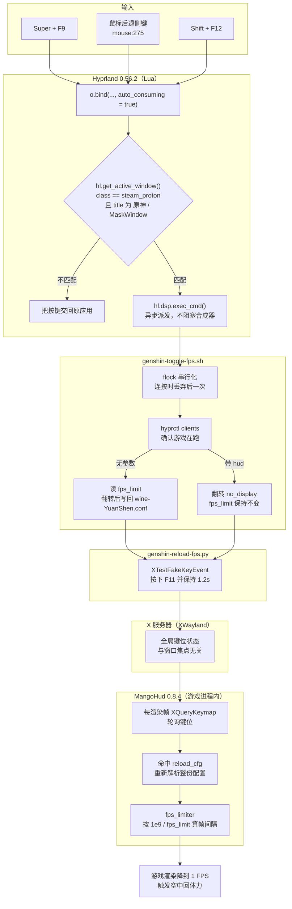
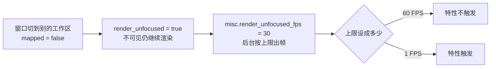

# 结论：只锁帧率就够了

这次折腾最初只是想控制原神的“后台模式”：切走工作区时可以继续正常渲染，游戏仍显示在屏幕上时又能用快捷键主动降低帧率。

具体利用的是**薇斯纳在空中回复体力的低帧率特性**。最初以为必须让游戏进入后台，后来通过对照实验发现，在这套环境里，不隐藏游戏、只把帧率限制到足够低，也能触发。

最终留下的是一套限帧切换：Win + F9 和鼠标后退侧键共用一个处理函数，在 1 FPS 与正常帧率之间切换；Shift + F12 控制 MangoHud 的显示与隐藏。

# 环境与最初现象

排查时记录的环境如下，结论首先适用于这组版本与显示器拓扑。

| 项目 | 实际环境 |
| --- | --- |
| 桌面 | Omarchy、Hyprland 0.56.2，使用 Lua 配置 |
| 运行器 | DWProton 11.0-15 |
| 窗口协议 | 原神通过 XWayland 运行 |
| XWayland | 24.1.14-1 |
| 限帧工具 | MangoHud 0.8.4 |
| 显示器 | 主屏在左，副屏在右 |
| 缩放 | 主屏约 1.6667 倍，副屏 1 倍；启用 XWayland 零缩放选项 |
| 游戏窗口 | `class = "steam_proton"`，标题为 `原神` |

主屏显示原神时，把焦点移到副屏聊天，并不会触发最初观察到的后台特性。必须把**原神所在的主屏切到另一个工作区**，效果才会出现。

这已经说明，不能把“失去焦点”和“窗口不再显示”混为一谈。副屏获得焦点时，原神仍然显示在主屏；切走主屏工作区后，原神才真正不可见。

# 从“后台特性”定位到低帧率

已有的操作经验是：手机上可以通过返回键卡出空中回体力的效果；Windows 上常见的操作是切到窗口模式，再右键窗口标题栏，利用窗口菜单期间的停顿获得类似效果。

这些是寻找触发条件的背景。本文没有对手机和 Windows 的进程、线程做跟踪，因此不把这些现象一概表述为“整个游戏进程被暂停”。本次新增的实测结果是：**Linux 下不必依赖这些操作，只锁帧率也可以触发薇斯纳的空中回体力。**

实验分两步进行。

**第一步：只改变隐藏窗口的渲染频率。**

为原神开启 `render_unfocused`，让窗口不可见时仍继续渲染，再通过 `misc.render_unfocused_fps` 调整后台渲染上限。Hyprland 对这两个设置的定义分别见[窗口规则](https://wiki.hypr.land/Configuring/Basics/Window-Rules/)和[配置选项](https://wiki.hypr.land/configuring/core/config-options/)。

| 条件 | 实测结果 |
| --- | --- |
| 原神仍显示在主屏，只把焦点移到副屏 | 不触发最初观察到的特性 |
| 切走主屏工作区，隐藏时继续以最高 60 FPS 渲染 | 特性不触发 |
| 同样隐藏，但把后台上限降到 1 FPS | 特性触发 |

**第二步：不隐藏窗口，直接限制游戏渲染帧率。**

Hyprland 的后台渲染参数并不是可见窗口的通用单独限帧器，因此改用已经加载到游戏中的 MangoHud。

| MangoHud 限制 | 实测结果 |
| --- | --- |
| 1 FPS | 画面可见时也能触发，效果与 Hyprland 隐藏时限制到 1 FPS 接近 |
| 2 FPS | 有效果，但弱于 1 FPS |
| 4 FPS | 做过配置试验，没有得到足以单列结论的效果反馈 |
| 10 FPS | 确认无法触发目标效果 |

最终恢复到 1 FPS。1 FPS 与 2 FPS 的帧间隔分别约为 1000 ms 和 500 ms，差异足以影响某些按帧推进、计时或状态检查逻辑。

不过，**这些实验只能证明效果与极低帧率密切相关，不能证明游戏全部逻辑都与渲染同步，也不能直接把原因定为“逻辑帧率和渲染帧率冲突”**。具体是哪一段体力、动作或空中状态逻辑受到影响，仍未通过游戏内部实现验证。

# 限帧切换踩过的坑

MangoHud 支持按应用配置。Wine 应用的文件名使用 `wine-程序名.conf`，不带 `.exe` 后缀，因此原神使用：

```text
~/.config/MangoHud/wine-YuanShen.conf
```

配置格式和优先级可以参考 [MangoHud 官方说明](https://github.com/flightlessmango/MangoHud#hud-configuration)。本机最终使用的关键配置是：

```ini
# 0 表示不施加 MangoHud 的帧率上限，仍保留游戏自身的限制。
fps_limit=0
no_display=1
show_fps_limit
reload_cfg=F11
```

切换脚本修改 `fps_limit`，然后触发重载。这里不是把环境变量写入已经运行的游戏进程，也没有重启游戏。

最初尝试过 MangoHud 的左 Shift + F1 切换，以及通过 Hyprland 转发瞬时重载按键，但没有可靠生效。排查时一度只看见命令返回 `ok`，就误以为配置已经加载，这是整个过程里应该纠正的一点：**按键发送成功与游戏实际限帧，是两个验证目标。**

后续通过截图检查 HUD，才确认限制为 1 FPS 时出现约 1000 ms 的帧时间，恢复正常后回到约 99 FPS。`FPS limit` 字段与实际帧率也要区分，统计值可能需要经过后续几帧才刷新。

## 为什么是重载，而不是“切换”

很自然会想到用 MangoHud 自带的 `toggle_fps_limit`，它只改内存状态，不用重解析配置。但看过实现后这条路走不通。

按键判定是每帧轮询的，而且**不要求松开**：

```cpp
// keybinds.cpp:45
if (elapsedFpsLimitToggle >= keyPressDelay &&
    keys_are_pressed(real_params->toggle_fps_limit)) {
   toggle_fps_limit_press = now;
   fps_limiter->next_limit();
}
```

`keyPressDelay` 只有 400 ms。按住不放，每 400 ms 就再切一次。而限制到 1 FPS 之后，这一整套检查每秒才跑一次，短按又有很大概率落在两次检查之间被漏掉。

也就是说：要保证按到，得按住一秒以上；按住了，又会重复触发。**有状态的切换在 1 FPS 下不可靠，幂等的重载才是能用的手段。** 重载十次和重载一次结果相同，所以脚本可以放心地按住 1.2 秒。

另外也试过 `mangohudctl set reload_config true`，当时甚至把随后出现的限帧效果归因于它。看过 `control.cpp` 才发现，这个控制接口只实现了 `hud`、`logging`、`fcat` 三个命令，**既没有重载，也没有设置 `fps_limit`**。控制 socket 还需要在配置里显式写 `control=` 才会开启。那条路从一开始就不存在。

## 重载会悄悄复位 HUD

这是代价最大、也最不直观的一个坑。

`reload_cfg` 命中的处理是**整份配置重新解析**，而解析的第一步就是把参数结构体清零：

```cpp
// overlay_params.cpp:960
parse_overlay_config(struct overlay_params *params, ...) {
   *params = {};          // 所有布尔量归零，no_display = false
   ...
}
```

`no_display` 只有在配置文件里写了才会被重新赋值。原来的配置里没有这一行，于是每触发一次重载，用 Shift + F12 隐藏掉的 HUD 就会重新弹出来。

更糟的是按键判定不要求松开：按住 1.2 秒期间，重载会真的执行两到三次，每次都把 HUD 打回显示。

解决办法不是“把默认值改成隐藏”——那只是把 bug 翻了个面，你正开着 HUD 时切一次照样会被藏掉。真正的做法是**让配置文件成为唯一事实来源**：既然重载一定会把状态复位成文件里的值，那就保证文件里的值始终等于你当前的选择。

于是 Shift + F12 也交给同一个脚本处理：翻转配置里的 `no_display`，再发送重载键。这样两个方向都不会被反转——藏着的一直藏着，开着的一直开着。

## 那一步“先聚焦游戏”其实是多余的

早期脚本在改配置之前会先执行一次 `hyprctl dispatch focus`，理由是“让模拟的重载按键送到游戏窗口”。这个理由不成立。

MangoHud 判断按键用的是整张键盘状态表，不看窗口焦点：

```cpp
// keybinds.h
libx11->XQueryKeymap(get_xdisplay(), keys_return);
```

`XTestFakeKeyEvent` 注入的按键会写进 X 服务器的键位状态，MangoHud 轮询时就能读到。这一行不仅没用，还会把游戏窗口提到最前，反而引起别的窗口跟着变化。已经删掉。

**为什么最初会“卡手”？**

早期重载组合键设成了 Ctrl + Shift + F11，脚本会模拟按住这组键约 1.2 秒。它与用户真正按着的修饰键存在冲突风险，连续触发时还可能重叠。后来做了几项调整：

- 重载改成单独的 F11，不再模拟 Ctrl、Shift。
- 快捷键在松开后触发。
- 用 `flock` 防止两次切换并发执行。
- 先确认原神窗口存在，再执行切换。

仍保留约 1.2 秒的按键保持时间，是因为 1 FPS 下每秒才轮询一次按键。这是当前脚本的局限，**不能把它宣传成瞬时、完全顺滑的切换实现**。

## Shift + F12 把按键从别的应用手里抢走了

这套配置用了几天之后，暴露了一个和限帧无关的问题：在 CS2 里按 Shift + F12 关不掉 MangoHud。

原因不在游戏，也不在 MangoHud。`o.bind` 最终落到 `hl.bind`，是标准的 Hyprland 绑定——命中之后由合成器消费按键，不再下发给客户端。脚本内部用 `hyprctl clients` 判断“当前是不是原神窗口”，但到那一步已经太晚了：**脚本能决定要不要干活，决定不了按键要不要交给游戏。**

改完之后查询运行时绑定（`hyprctl binds -j`，节选），这条带上了消费策略：

```json
{
  "modmask": 1,
  "key": "F12",
  "auto_consuming": true,
  "dispatcher": "function: 0x556aee535eb0",
  "description": "原神：切换 MangoHud 显示"
}
```

改之前 `auto_consuming` 是 `false`，`dispatcher` 是 `HL.Dispatcher(exec_cmd)`。也就是说，任何窗口有焦点时按下这组键，都只会去执行那个脚本，然后脚本发现不是原神就 `exit 0`——按键消失了，游戏那边什么也没发生。这套绑定在 0.57.0 上依然如此，结论不变（本文其余部分的实测环境仍是 0.56.2）。

修法和 F9 一致：把窗口判断从脚本提前到 dispatcher 函数里，用返回值告诉合成器这一下要不要消费。

```lua
-- 原来：无条件消费，判断放在脚本里已经来不及
o.bind("SHIFT + F12", "原神：切换 MangoHud 显示", toggle_fps_command .. " hud")

-- 现在：判断提前到 dispatcher，非原神窗口返回 ok = false
o.bind("SHIFT + F12", "原神：切换 MangoHud 显示", toggle_hud, { auto_consuming = true })
```

`toggle_hud` 与 `toggle_fps` 同构，完整写法见下一节的最终配置。原神窗口内行为不变：判断通过、执行脚本、消费按键；其他窗口返回 `{ ok = false }`，按键原样下发给当前客户端。

两点边界要单独说清楚。

**第一，按键透传和 HUD 响应是两件事。** 这次只验证到按键会交给客户端，没有验证 CS2 里 MangoHud 是否真的响应。原神走 XWayland，MangoHud 用 `XQueryKeymap` 轮询 X 服务器的键位状态，这条路径是确定的；CS2 自带 `libSDL3.so.0`，在 Wayland 会话下大概率是原生 Wayland 窗口，MangoHud 0.8.4 面对这种情况走的是另一套键盘实现（自建 `wl_seat`、`wl_keyboard` 加独立事件队列），没有验证过。如果放行之后依然关不掉，那就不再是绑定层的问题了。

**第二，MangoHud 的默认键是右 Shift。** `toggle_hud` 默认值是 `Shift_R+F12`，本文一直写“Shift + F12”是简称。左 Shift 从来不在默认绑定里，而 Hyprland 的 `SHIFT` 左右都匹配——所以在修掉消费问题之前，按哪边都一样没用。

# 最终保留的配置

Hyprland 只负责“接到按键、判断窗口、把活派出去”，真正改帧率的是 MangoHud。整条链路横跨合成器、shell、X 服务器和游戏进程四层，先看全景：



链路里有两处容易被忽略的取舍，图上看不出来，要单独说明：

**第一，`XTestFakeKeyEvent` 走的是全局键位状态，不是窗口消息。** 所以脚本不需要先把游戏提到前台——那一步反而是早期版本的 bug 来源。代价是这个按键对当前真正获得焦点的窗口也是可见的，只是 F11 在游戏里没有用途。

**第二，最后一步是“重载”而不是“设置”。** MangoHud 没有提供设置 `fps_limit` 的运行时接口，只能改配置文件再让它重读。这就是为什么中间要多一次写文件、多一次注入按键——不是因为设计喜欢绕路，而是能用的接口只有这一个。

隐藏窗口那条路径则完全不需要 MangoHud，由 Hyprland 自己完成：



两条路径的机制不同：一条是合成器决定“给多少帧”，一条是应用自己“睡多久再出帧”，但最终都归结为同一个量——帧间隔。这也是为什么 1 FPS 下两者效果接近。

具体实现拆成三个职责，而不是让 Lua 回调等待外部命令。

| 文件 | 职责 |
| --- | --- |
| `~/.config/hypr/apps/genshin_impact.lua` | 窗口规则与快捷键入口 |
| `~/.config/hypr/apps/genshin-toggle-fps.sh` | 查找游戏、串行切换 `fps_limit` 与 `no_display` |
| `~/.config/hypr/apps/genshin-reload-fps.py` | 通过 XTest 短期保持并释放 F11 |

Python 脚本使用 `ctypes` 调用系统已有的 `libX11` 与 `libXtst`，在 `finally` 中释放按键。它是按键模拟，不是向游戏注入代码。

Hyprland 侧：

```lua
local toggle_fps_command = "/bin/bash " .. os.getenv("HOME") .. "/.config/hypr/apps/genshin-toggle-fps.sh"

hl.window_rule({
  match = {
    class = "steam_proton",
    title = "原神",
  },
  no_dim = true,
  render_unfocused = true,
})

hl.config({ misc = { render_unfocused_fps = 30 } })

-- 两个输入入口共用一个处理函数和注册循环。
local function toggle_fps()
  local window = hl.get_active_window()
  if window and window.class == "steam_proton" and (window.title == "原神" or window.title == "MaskWindow") then
    hl.dispatch(hl.dsp.exec_cmd(toggle_fps_command))
    return { ok = true }
  else
    return { ok = false }
  end
end

for _, keys in ipairs({ "SUPER + F9", "mouse:275" }) do
  o.bind(keys, "原神：切换 1 FPS / 正常帧率", toggle_fps, { release = true, auto_consuming = true })
end

-- HUD 可见性走同一个脚本：先写回配置再重载，重载就不会改变选择。
local function toggle_hud()
  local window = hl.get_active_window()
  if window and window.class == "steam_proton" and (window.title == "原神" or window.title == "MaskWindow") then
    hl.dispatch(hl.dsp.exec_cmd(toggle_fps_command .. " hud"))
    return { ok = true }
  else
    return { ok = false }
  end
end

-- auto_consuming：只在匹配到原神窗口时消费按键，其余窗口透传。
o.bind("SHIFT + F12", "原神：切换 MangoHud 显示", toggle_hud, { auto_consuming = true })
```

这是针对本机窗口标题、class 和 Omarchy `o.bind` 辅助函数的示例。直接使用 Hyprland 的环境需要改用自己的加载方式或 `hl.bind`，不能假设存在 `o`。

两个输入入口并不是把两个按键合成一个绑定，而是共用同一个处理函数——改一次条件判断，两个入口同时生效。侧键只在匹配到游戏窗口时消费，其他应用保留原有后退行为。`mouse:275` 是本机的后退侧键编号，其他硬件应检查实际事件。

条件里的 `MaskWindow` 是 BetterGI 的透明遮罩窗口。它被设成 `no_focus`，正常情况下不会成为活动窗口，所以这个分支很少真正命中，属于兜底。

后台上限在最初对照实验中使用的是 60 FPS，最终文件保留为 30 FPS。这个参数是全局的，也会影响其他启用了 `render_unfocused` 的隐藏窗口。

修改前先备份涉及的用户文件，修改后执行：

```bash
hyprctl reload
hyprctl configerrors
```

配置检查通过只说明加载没有报告错误，仍需要在实际游戏内验证左右转动、限帧切换和恢复。回滚时恢复自己修改前的文件并再次重载，不要直接重置整套用户配置。

# 从 .conf 转向 .lua，是极其好的设计

经历这次排查，我认为 **Hyprland 把配置从 `.conf` 转向 `.lua`，是一个极其好的设计**。

更准确地说，旧 `.conf` 使用的是 Hyprlang；官方文档说明，从 Hyprland 0.55 起，Hyprlang 被弃用并转向 Lua。这里讨论的不是改了文件扩展名，而是配置表达能力的变化。

这次最直接的收益有三个。

**第一，重复配置可以真正抽象。** Win + F9 与鼠标侧键共用处理函数、命令变量和注册循环。修复一次条件判断，就能同时作用于两个入口，而不是靠复制粘贴保持一致。

**第二，条件可以在触发时判断。** 使用 `hl.get_active_window()` 检查当前窗口，再决定执行命令还是把按键交回应用。相比拼接一层层 shell 分支，行为更容易读清楚，也更容易核对绑定数量。

**第三，规则和自动化能在同一种语言里组织。** 窗口规则、快捷键、事件回调可以放在同一个结构里。`hl.on` 支持 `window.open`、`layer.opened` 这类事件，配置因此不只是静态声明，还能对运行期变化做出反应——这在 Hyprlang 时代得靠外部脚本轮询。

Lua 也不会自动消除坏设计。最初重复定义入口、不断叠加补丁的做法仍然很差；把阻塞操作搬进 Lua 回调还可能影响合成器响应。因此限帧脚本通过 `hl.dsp.exec_cmd` 异步执行，Lua 只负责判断和派发，不在桌面事件回调里等待 1.2 秒。

更好的配置语言让逻辑更容易表达、复用与检查，但它不能替 MangoHud 修复一个本来就没实现的运行时接口。

# 这次折腾留下的边界

可以确认的是：本机通过极低渲染帧率触发了薇斯纳空中回体力，隐藏工作区与可见窗口的 1 FPS 效果接近；无需把“进入后台”当成唯一条件。

可以保留的是：MangoHud 的 1 FPS 切换，以及把配置文件当作唯一事实来源的那套写法。

**需要说明的是切换的实现方式。** 它依赖模拟按键触发 MangoHud 重载，1 FPS 下响应本身就要等一个轮询间隔，所以切换有一到两秒延迟，不是即时的。MangoHud 没有提供设置 `fps_limit` 的运行时接口，这一点在 0.8.4 上无法绕开。

至于“为什么极低帧率会触发这个特性”，本文只做到现象层面的确认，没有验证游戏内部的实现。想继续深入，方向是游戏自身的帧循环、体力回复计时和状态机，而不是继续在桌面层调参数。
